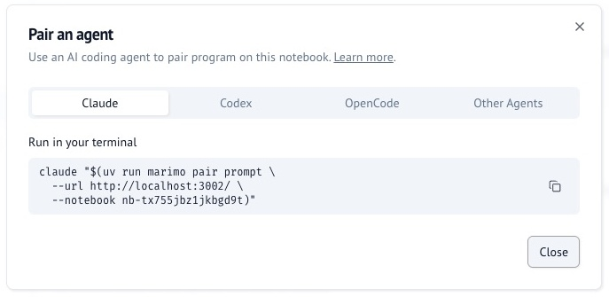

# marimo pair: work on notebooks with coding agents

Use **[marimo pair](https://marimo.io/pair)** to connect coding agents like
Claude Code, Codex, and OpenCode to running marimo notebooks. Once your agent
is paired with marimo, ask it to explore data, explain results, or modify
cells. The agent can inspect variables and try code in a scratchpad before it
commits changes to the notebook. You can inspect the results and edit the same
notebook yourself, letting you pair program with the agent.


<div style="text-align: center">
  <iframe width="100%" style="aspect-ratio: 16/9; max-width: 800px"
  src="https://www.youtube.com/embed/VKvjPJeNRPk?si=JMvoFiDFNtT1BsJY"
  title="YouTube video player" frameborder="0" allow="accelerometer; autoplay;
  clipboard-write; encrypted-media; gyroscope; picture-in-picture; web-share"
  referrerpolicy="strict-origin-when-cross-origin" loading="lazy" allowfullscreen></iframe>
</div>

## Installation

The marimo pair skill teaches your agent how to connect to running notebooks.
Choose the installation method for your agent.

=== "Claude Code"

    Run these commands in your terminal:

    ```bash
    claude plugin marketplace add marimo-team/marimo-pair
    claude plugin install marimo-pair@marimo-pair
    ```

    To update the plugin, run:

    ```bash
    claude plugin update marimo-pair@marimo-pair
    ```

=== "Codex CLI"

    Run these commands in your terminal:

    ```bash
    codex plugin marketplace add marimo-team/marimo-pair
    codex plugin add marimo-pair@marimo-pair
    ```

    To update the marketplace, run:

    ```bash
    codex plugin marketplace upgrade
    ```

=== "Other agents"

    For Cursor, VS Code, Gemini CLI, OpenCode, Copilot CLI, or another agent that supports Agent Skills, run:

    ```bash
    npx skills add marimo-team/marimo-pair
    ```

    To update the skill, run:

    ```bash
    npx skills upgrade marimo-team/marimo-pair
    ```

    If you use `uv` instead of `npx`, install the skill with:

    ```bash
    uvx deno -A npm:skills add marimo-team/marimo-pair
    ```

## Start pairing

### Ask your agent to start a notebook

With the skill installed, ask your agent to start a notebook:

=== "Claude Code"

    ```text
    /marimo-pair with me on notebook.py
    ```

=== "Codex CLI"

    ```text
    $marimo-pair with me on notebook.py
    ```

=== "Other agents"

    ```text
    /marimo-pair with me on notebook.py
    ```

The agent starts marimo and connects to the notebook.


### Connect to a running notebook

1. Open the notebook's **Actions menu** and select **Pair an agent**.
2. In the **Pair an agent** dialog, select your agent.
3. Click **Copy command**, then paste and run the command in your terminal.

=== "Actions menu"

    

=== "Pairing dialog"

    

!!! tip "Pair with notebooks on molab"

    You can also pair your local agent with notebooks on
    [molab](https://molab.marimo.io/notebooks). Just follow these same steps.

Watch the connection steps for your agent:

=== "Claude Code"

    <video muted loop playsinline controls preload="metadata" width="100%"
      poster="https://cms.marimo.io/landing/pair/claude-boot.webp"
      aria-label="Connect Claude Code to a marimo notebook">
      <source src="https://cms.marimo.io/landing/pair/claude-boot.webm" type="video/webm">
      <source src="https://cms.marimo.io/landing/pair/claude-boot.mp4" type="video/mp4">
    </video>

=== "Codex CLI"

    <video muted loop playsinline controls preload="metadata" width="100%"
      poster="https://cms.marimo.io/landing/pair/codex-boot.webp"
      aria-label="Connect Codex CLI to a marimo notebook">
      <source src="https://cms.marimo.io/landing/pair/codex-boot.webm" type="video/webm">
      <source src="https://cms.marimo.io/landing/pair/codex-boot.mp4" type="video/mp4">
    </video>

=== "Other agents"

    <video muted loop playsinline controls preload="metadata" width="100%"
      poster="https://cms.marimo.io/landing/pair/prompt-boot.webp"
      aria-label="Connect Other agents to a marimo notebook">
      <source src="https://cms.marimo.io/landing/pair/prompt-boot.webm" type="video/webm">
      <source src="https://cms.marimo.io/landing/pair/prompt-boot.mp4" type="video/mp4">
    </video>

Ask your agent to explore data, explain results, or modify cells.
The agent can inspect variables and try code in a scratchpad before it changes the notebook.
You can inspect the results and edit the same notebook yourself.
Your work stays in a notebook that you can run again, modify, and share.

## Receive notebook messages

Inside Claude Code, Codex, or OpenCode 2.0, the first `pair execute` attempts an inbox connection automatically.
If notebook messaging is unavailable, execution continues.
For supported harnesses, retry once. If it fails, continue without messaging:

```bash
marimo pair connect --session <notebook-ID>
```

Target selection and authentication follow the shared Pair command rules in `marimo pair --help`.
Run `marimo pair connect --help` for connection options.
